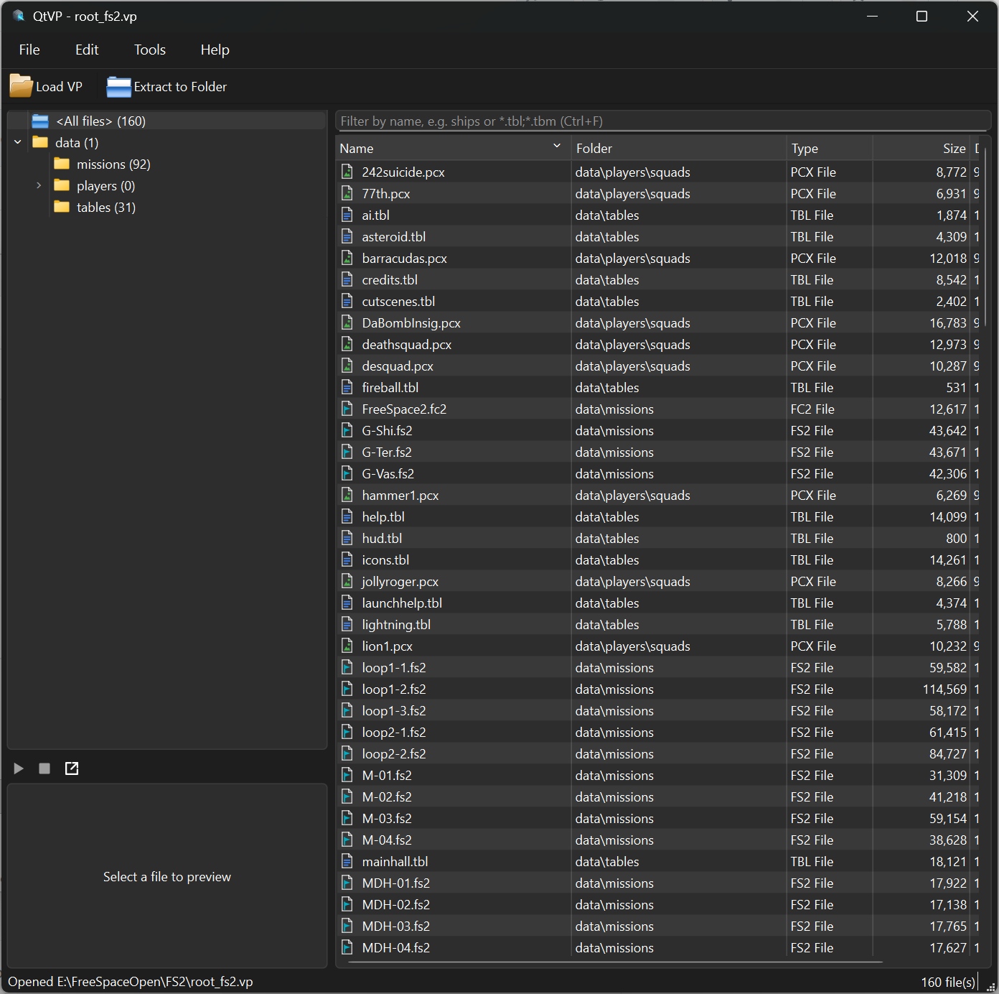

<br />
<div align="center">
  <a href="https://github.com/MjnMixael/QtVP">
    
  </a>

  <h3 align="center">QtVP</h3>

  <p align="center">
    A VP archive viewer and extractor for FreeSpace Open.
  </p>
</div>

## About

QtVP is a Qt-based VP archive viewer and extractor for the FreeSpace Open engine. It keeps the familiar VPView32 layout (folder tree, file list, resizable preview pane) and brings it up to date with the formats the modern engine uses.

QtVP uses [Qt Designer](https://www.qt.io/product/ui-design-tools) for its UI development.

## Features

- Open VP archives and browse their folders
- Extract selected files, folders, or the whole archive; drag files straight out to the file manager
- Open files in their usual app: ANI/EFF in AnimStudio, POF in POF Tools, everything else in the system default
- Preview images (PCX, TGA, DDS, PNG, JPG), animations (ANI, EFF, APNG), and sounds (WAV, OGG)
- Create and edit VPs: add, remove, rename, and save
- Read compressed (LZ41) VP entries
- Light and dark themes, or follow the system
- Cross-platform (Windows/Linux) and fast, native performance

## Building

QtVP builds with CMake and Qt 6.8.3 (Core, Gui, Widgets, Multimedia, MultimediaWidgets, Concurrent). It builds on Windows (MSVC) and Linux (GCC/Clang); the GitHub Actions workflow builds and packages both.

### Requirements

- CMake 3.21+
- Qt 6.8.3, including the `qtmultimedia` module
- A C++17 compiler — MSVC (Visual Studio 2026) on Windows, GCC or Clang on Linux

### Visual Studio 2026

Generate the solution against your Qt install, then open it:

```bash
cmake -S . -B build/vs2026 -G "Visual Studio 18 2026" -A x64 -DCMAKE_PREFIX_PATH=C:/Qt6/6.8.3/msvc2022_64
```

Open `build\vs2026\QtVP.slnx` and build/run with F5 (QtVP is the default startup project). Alternatively, use **File → Open → Folder** on the repo root — VS reads `CMakePresets.json` directly.

### Command line (Linux or Windows)

```bash
cmake -S . -B build -G Ninja -DCMAKE_BUILD_TYPE=Release -DCMAKE_PREFIX_PATH=/path/to/Qt/6.8.3/gcc_64
cmake --build build
```

## Usage



Load an archive with **Load VP** (or File → Open), then browse the folder tree and file list. Select a file to preview it in the right-hand pane — images, animations, and sounds render in place. Use **Extract to Folder** to pull out selected files, folders, or the whole archive, or drag entries straight to your file manager. Create and edit archives from the Edit menu (add, remove, rename, and save). Files with an associated tool open there; everything else opens in the system default app.

## Dependencies

QtVP bundles a few small open-source libraries:

- **[LZ4](https://github.com/lz4/lz4)** 1.10.0 – Fast (de)compression for LZ41 VP entries. BSD 2-Clause; see `QtVP/Dependencies/lz4/LICENSE`.
- **[bcdec](https://github.com/iOrange/bcdec)** 0.985 – BC/DXT texture decoding for DDS previews. MIT or Unlicense.
- **[etcdec](https://github.com/iOrange/etcdec)** 0.91 – ETC texture decoding. MIT or Unlicense.

## Known Issues

- None currently!

# Credits

QtVP is developed by MjnMixael.
Licensed under the GNU GPL v3. See [LICENSE](LICENSE).
